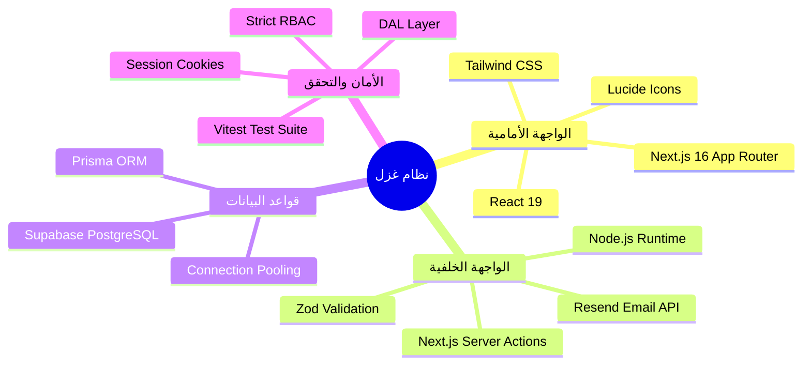
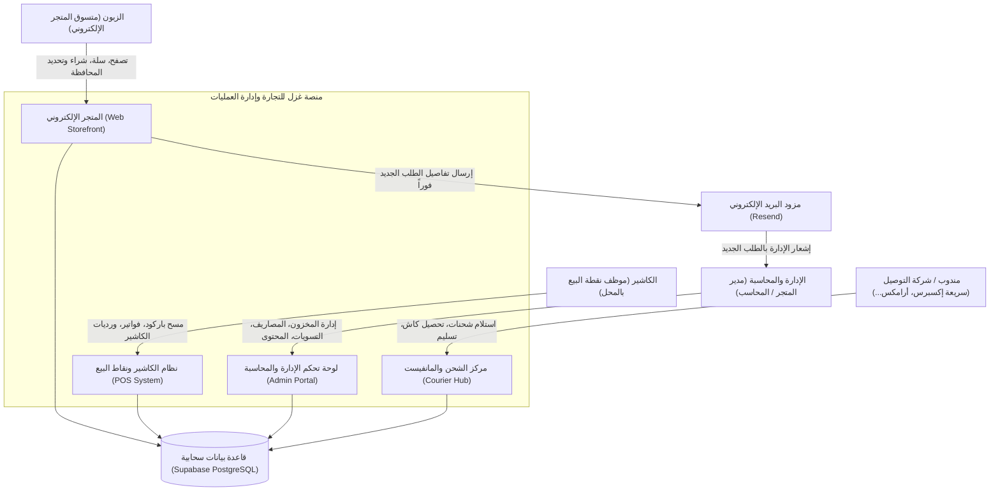
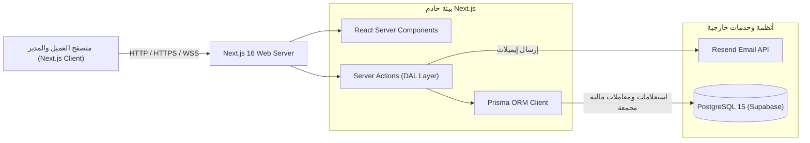
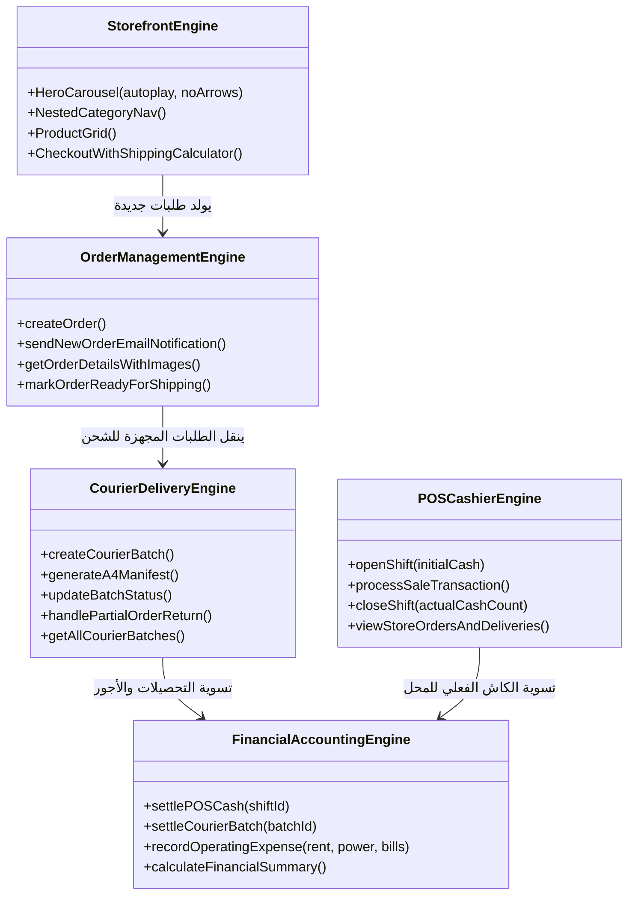
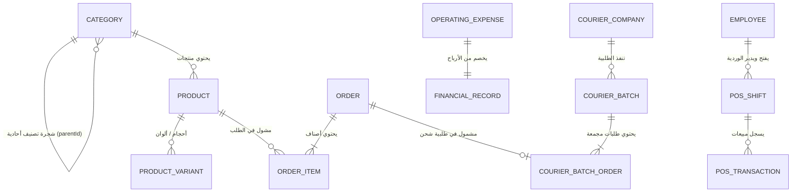
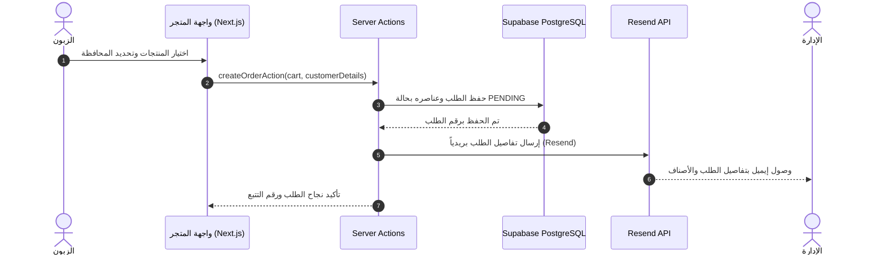
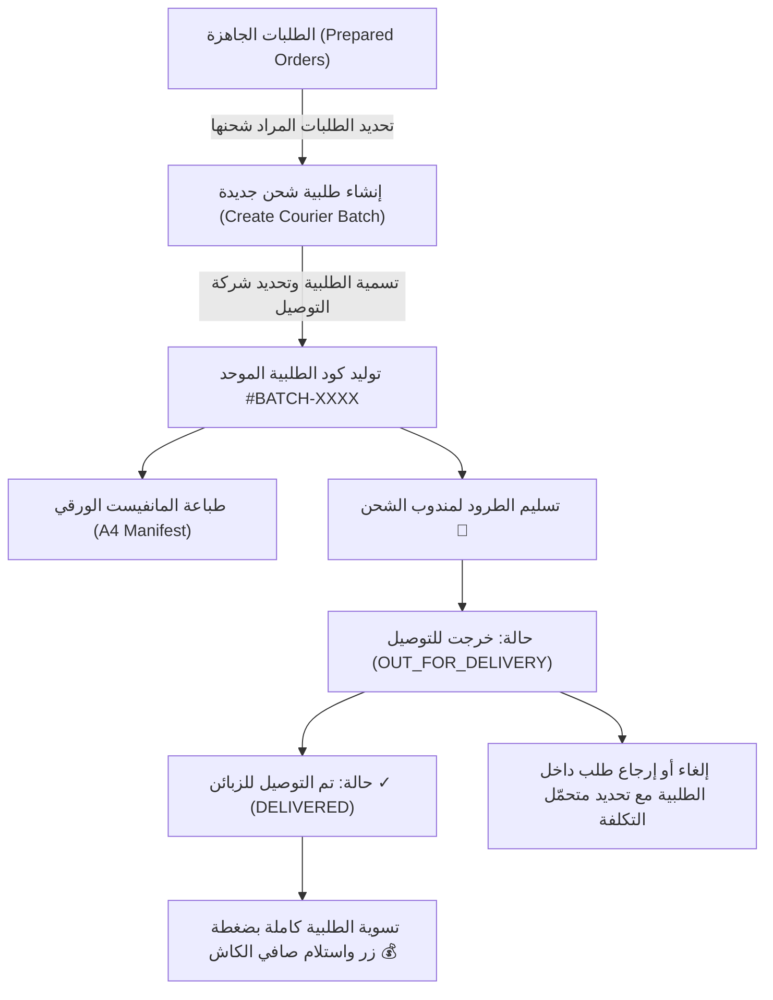

# التقرير الفني والمعماري الشامل لنظام متجر ونقاط بيع غزل
## Ghazal Omnichannel Commerce & Enterprise Management System
**تاريخ التقرير:** 24 نوفمبر 2026 | **الإصدار:** Production 2.4.0 | **البيئة التشغيلية:** Next.js 16 + React 19 + Supabase PostgreSQL

---

## فهرس المحتويات
1. [الملخص التنفيذي ونطاق العمل (Executive Summary)](#1-الملخص-التنفيذي-ونطاق-العمل)
2. [حزمة التقنيات الشاملة (Full Technology Stack)](#2-حزمة-التقنيات-الشاملة)
3. [الهيكلية المعمارية الشاملة ونماذج C4 (System Architecture)](#3-الهيكلية-المعمارية-الشاملة-ونماذج-c4)
4. [مخطط قواعد البيانات ونماذج الـ Schema (Data Models & Schemas)](#4-مخطط-قواعد-البيانات-ونماذج-الـ-schema)
5. [مسارات العمل وسير العمليات بالتفصيل (Detailed Workflows)](#5-مسارات-العمل-وسير-العمليات-بالتفصيل)
   - [5.1 مسار الشراء الإلكتروني للمستهلك (Storefront Checkout Flow)](#51-مسار-الشراء-الإلكتروني-للمستهلك)
   - [5.2 مسار التنبيهات البريدية التلقائية عبر Resend](#52-مسار-التنبيهات-البريدية-التلقائية-عبر-resend)
   - [5.3 مسار إدارة الطلبات وتجهيزها في لوحة الإدارة](#53-مسار-إدارة-الطلبات-وتجهيزها-في-لوحة-الإدارة)
   - [5.4 مسار طلبيات وشحنات شركة التوصيل (Manifests & Batches)](#54-مسار-طلبيات-وشحنات-شركة-التوصيل)
   - [5.5 مسار الكاشير ونقاط البيع السحابية (POS Cashier Operations)](#55-مسار-الكاشير-ونقاط-البيع-السحابية)
   - [5.6 مسار المحاسبة والتسويات والمصاريف التشغيلية](#56-مسار-المحاسبة-والتسويات-والمصاريف-التشغيلية)
6. [هندسة النزاهة المالية والأمان (Financial Integrity & Security)](#6-هندسة-النزاهة-المالية-والأمان)
7. [دليل هيكل ملفات ومجلدات المشروع (Project Directory Tree)](#7-دليل-هيكل-ملفات-ومجلدات-المشروع)
8. [التحقق والاختبارات التلقائية (Verification & Tests)](#8-التحقق-والاختبارات-التلقائية)

---

## 1. الملخص التنفيذي ونطاق العمل
نظام **غزل (Ghazal Makeup & Beauty)** هو منصة تجارة وإدارة سحابية متعددة القنوات (Omnichannel Enterprise Commerce) مصممة خصيصاً لسوق مستحضرات التجميل والعناية بالأردن. يدمج النظام بين:
1. **متجر الويب الفاخر للعملاء (B2C E-commerce):** تجربة تصفح تفاعلية سريعة، أقسام رئيسية وفرعية مرنة، بانرات إعلانية ذكية بتناوب تلقائي سلس، وسلة شراء مربوطة باحتساب ديناميكي لتكلفة التوصيل لكل محافظة أردنية.
2. **نظام نقاط البيع السحابي للمحل (Cloud POS / Cashier Workspace):** شاشة كاشير فائقة الاستجابة، دعم مسح الباركود، إدارة ورديات الكاشير، عهدة البداية والنهاية، والتعامل مع طلبات المتجر وطلبيات التوصيل دون مغادرة بيئة الكاشير المحمية.
3. **مركز لوجستيات التوصيل والمانفيست (Courier Dispatch & Manifest Hub):** تجميع الطلبات في "طلبيات شحن مجمعة" (Courier Batches)، إصدار مانفيست مطبوع قياس A4، متابعة التسليم والتحصيل عند الاستلام (COD)، إدارة شركات التوصيل والمناديب، ومطابقة أسعار التوصيل حسب كل محافظة.
4. **النظام المالي والمحاسبي المتكامل (Accounting & Settlements Engine):** تسوية كاش نقاط البيع، تسوية طلبيات التوصيل المجمعة بضغطة زر واحدة، تسجيل المصاريف التشغيلية (إيجار المحل، فواتير الكهرباء والمياه، رواتب، مصاريف نثرية)، وخصمها من الأرباح الصافية لعرض صورة مالية حقيقية للمتجر.

---

## 2. حزمة التقنيات الشاملة



### 2.1 الواجهة وتجربة المستخدم (Frontend)
- **Next.js 16 (App Router):** الاستفادة الكاملة من خوادم React ومكونات السيرفر (Server Components) لسرعة العرض الأول، والـ Streaming SSR لتقليل زمن الاستجابة (TTFB).
- **React 19:** استخدام أحدث الخطافات والميزات مثل `useTransition` و `useActionState` و `React Server Actions` لتنفيذ الإجراءات الخلفية بدون إنشاء نقاط نهاية REST تقليدية.
- **Tailwind CSS & Design System:** نظام تصميم متكامل بهوية مستحضرات التجميل الراقية بلون العاج (`ivory`)، الفحم الداكن (`charcoal`)، ولون غزل الوردي الشهير (`#E6007E`).
- **Lucide React:** مكتبة أيقونات متناسقة وخفيفة لجميع العمليات.

### 2.2 محرك الخادم وقواعد البيانات (Backend & Database)
- **Supabase Cloud (PostgreSQL):** قاعدة بيانات سحابية موثوقة ذات أداء عالٍ، تدعم التوسع والنسخ الاحتياطي اللحظي.
- **Prisma ORM 5.x:** نموذج بيانات مكتوب بالكامل (Type-safe Schema) يضمن عدم حدوث أخطاء runtime في العمليات والتحويلات المالية.
- **Resend API:** بوابة إرسال رسائل البريد الإلكتروني الفورية عند تلقي طلبات جديدة وتحديثات الحالات.

### 2.3 الجودة والتحقق (Quality & Testing)
- **TypeScript 5 (Strict Mode):** منع الأخطاء النمطية تماماً (`0 errors` مع `tsc --noEmit`).
- **Vitest 4.x:** اختبارات وحدات سريعة جداً وموثوقة تغطي العمليات المالية (Money / Fils calculations)، النزاهة المحاسبية، وتكامل الكاشير والتصنيفات.

---

## 3. الهيكلية المعمارية الشاملة ونماذج C4

### 3.1 المستوى 1: مخطط السياق العام (C4 Context Diagram)
يوضح هذا المخطط تفاعل المستخدمين والأنظمة الخارجية مع منصة غزل:



---

### 3.2 المستوى 2: مخطط الحاويات (C4 Container Diagram)
يوضح المكونات التقنية الداخلية وكيفية اتصالها:



---

### 3.3 المستوى 3: بنية وحدات النظام (Component Architecture)



---

## 4. مخطط قواعد البيانات ونماذج الـ Schema

### 4.1 الجداول والعلاقات الأساسية
يوضح مخطط الكيانات العلاقات المركزية داخل النظام:



### 4.2 تفصيل الكيانات الجوهرية (Schema Entities)

| الكيان / الجدول | الوظيفة التقنية | الحقول الجوهرية |
| :--- | :--- | :--- |
| **`Category`** | إدارة الأقسام مع دعم شجرة التصنيف الفرعية لعمق مستوى واحد والسحب والإفلات | `id`, `nameAr`, `nameEn`, `slug`, `parentId`, `displayOrder`, `icon`, `image` |
| **`Product`** | بيانات المنتجات والأسعار والتكلفة والباركود والمخزون مع قناة البيع المخصصة | `id`, `sku`, `barcode`, `nameAr`, `nameEn`, `retailPriceFils`, `costPriceFils`, `stock`, `channel` ('ONLINE'\|'POS'\|'SHARED') |
| **`Order`** | طلبات الشراء الواردة من المتجر الإلكتروني أو الهاتف | `id`, `orderNumber`, `customerName`, `customerPhone`, `city`, `address`, `subtotalFils`, `shippingFeeFils`, `totalFils`, `status` |
| **`CourierBatch`** | طلبية التوصيل المجمعة (المانفيست) لشركة الشحن | `id`, `batchNumber`, `courierName`, `status`, `totalCodFils`, `totalDeliveryFeeFils`, `netSettlementFils`, `notes`, `createdAt` |
| **`CourierCompany`** | شركات الشحن والمناديب المعتمدة | `id`, `name`, `phone`, `type`, `active`, `isDefaultStoreCourier`, `defaultFeeFils` |
| **`ShippingZone`** | أسعار التوصيل بالمحافظات للزبائن وتكلفتها علينا | `id`, `nameAr`, `governorateCode`, `customerShippingFeeFils`, `courierCostFils`, `isEnabled` |
| **`POSShift`** | ورديات الكاشير اليومية | `id`, `shiftNumber`, `cashierId`, `openingCashFils`, `expectedCashFils`, `actualCashFils`, `differenceFils`, `status` |
| **`OperatingExpense`** | المصاريف التشغيلية (إيجار، كهرباء، فواتير، رواتب) | `id`, `title`, `category`, `amountFils`, `paidAt`, `paymentMethod`, `notes`, `approvedBy` |
| **`HomepageHeroSlide`** | شرائح الهيرو الإعلانية في الصفحة الرئيسية | `id`, `titleAr`, `imageDesktopPath`, `displayOrder`, `isEnabled`, `internalPath`, `ctaAr` |
| **`HomepageHeroCarouselSettings`** | إعدادات دوران الهيرو التلقائي | `enabled`, `autoplayEnabled`, `autoplayIntervalMs`, `pauseOnHover`, `showIndicators`, `showNavigation` |

---

## 5. مسارات العمل وسير العمليات بالتفصيل

### 5.1 مسار الشراء الإلكتروني للمستهلك
1. **تصفح الواجهة الرئيسية والهيرو:**
   - تعرض الواجهة بانر الهيرو الإعلاني بتناوب تلقائي كل **4 ثوانٍ** مع شريط تقدم حركي بالأسفل ومؤشرات نقطية تفاعلية ودعم اللمس (Swipe) **بدون أسهم تشتت المظهر**.
2. **استكشاف الأقسام:**
   - تصفح المنتجات عبر الأقسام الرئيسية وتصنيفاتها الفرعية (مكياج، عناية بالبشرة، عطور، مزيلات عرق، عناية بالوجه...).
3. **السلة والحساب الدقيق:**
   - حساب فوري بالـ Fils الأردني لمنع أي خطأ كسور مالية.
4. **صفحة الدفع (Checkout):**
   - العميل يحدد المحافظة (عمان، إربد، الزرقاء، العقبة...)؛ يقوم النظام بالاستعلام عن سعر التوصيل المعتمد لتلك المحافظة وإضافته تلقائياً للإجمالي.
5. **تثبيت الطلب:**
   - حفظ الطلب في قاعدة البيانات بحالة `PENDING`، مع خصم المخزون المحجوز.



---

### 5.2 مسار التنبيهات البريدية التلقائية عبر Resend
عند تثبيت أي طلب جديد:
1. يتم استدعاء دالة `sendNewOrderAdminNotification(orderData)` في مسار الخادم الخلفي.
2. يتم بناء قالب HTML تفاعلي متجاوب يشمل:
   - عنوان الرسالة: **طلب جديد رقم #ORD-XXXX**
   - اسم العميل ورقم هاتفه والمحافظة والعنوان بالتفصيل
   - جدول بالأصناف المشتراة، الكمية، والسعر
   - إجمالي قيمة المنتجات، أجور التوصيل، والقيمة النهائية الواجب تحصيلها (COD).
3. إرسال الإشعار فوراً إلى البريد المعتمد للمتجر `admin@ghazal.jo`.

---

### 5.3 مسار إدارة الطلبات وتجهيزها في لوحة الإدارة
1. يفتح الآدمن صفحة `/admin/orders`.
2. يتم استعراض تفاصيل الطلب: **تظهر صور الأصناف بجانب أسمائها والباركود والكمية** لتمكين موظف التجهيز من التعرف البصري السريع على المنتج.
3. عند انتهاء تجهيز الطرد، ينقر الموظف على زر **"جاهز للشحن" (Ready for Shipping)**.
4. ينتقل الطلب تلقائياً من قائمة طلبات المتجر المفتوحة إلى قائمة **"الطلبات الجاهزة"** في مركز التوصيل (`/admin/deliveries?tab=ready`).

---

### 5.4 مسار طلبيات وشحنات شركة التوصيل (Manifests & Batches)
يعد هذا المسار العصب اللوجستي للنظام، حيث يعالج التوصيل على مستوى **"الطلبيات المجمعة" (Batches)** وليس الطلبات الفردية:



#### مميزات صفحة طلبيات التوصيل (`/pos/deliveries` و `/admin/deliveries`):
- **تبويب "كافة طلبيات التوصيل" (`?tab=all-orders`):**
  - يعرض جدول **معلومات الطلبيات** (رقم الطلبية، شركة الشحن، تاريخ وتوقيت الإرسال، عدد الطلبات داخل الطلبية، إجمالي التحصيل COD، أجور التوصيل، صافي المحل، وحالة الطلبية).
  - إمكانية البحث والفلترة حسب اسم شركة التوصيل أو الحالة.
  - زر **"عرض طلبات الشحنة"**: يفتح نافذة منبثقة تفاعلية تعرض بالتفصيل جميع الطلبات المشمولة داخل الطلبية مع أسماء العملاء وهواتفهم وصور المنتجات.
  - زر **"طباعة المانفيست"**: يولد كشف تسليم رسمي A4 جاهز للتوقيع من المندوب.
  - زر **"تسوية"**: ينقل فوراً لتسوية الطلبية واستلام الكاش عند اكتمالها.

---

### 5.5 مسار الكاشير ونقاط البيع السحابية (POS Cashier Operations)
- **بيئة كاشير معزولة ومستقلة:**
  - يعمل الكاشير بالكامل داخل مسارات `/pos/*` دون أي تحويل قسري إلى لوحة الإدارة (`/admin`).
  - إدراج شاشتي **"طلبات المتجر"** و **"طلبيات شركة التوصيل"** المخصصة للكاشير لتمكينه من تجهيز وتسليم الطرود للمناديب أثناء تواجده في المحل.
- **فتح الوردية (Open Shift):**
  - تسجيل عهدة النقد الافتتاحية (مثلاً 50.000 د.أ).
- **البيع ومسح الباركود:**
  - إضافة المنتجات بسرعة، تعديل الكميات، تطبيق الخصومات المسموحة، وإصدار فواتير البيع الفورية.
- **إغلاق الوردية (Close Shift):**
  - عد النقد الفعلي بالدرج ومطابقته مع المبيعات المسجلة لحساب أي عجز أو فائض وتوثيق تقرير الوردية.

---

### 5.6 مسار المحاسبة والتسويات والمصاريف التشغيلية
1. **تسوية طلبيات التوصيل:**
   - في `/admin/settlements?q=courier-settlements`، تظهر الطلبيات المنجزة، ويتم إجراء التسوية **لإجمالي الطلبية المجمعة** وليس لكل طلب منفرد، مع إظهار الصافي بعد خصم أجور التوصيل بدقة.
2. **تسجيل المصاريف التشغيلية (Operating Expenses):**
   - قسم مخصص لتسجيل مصاريف المحل:
     - إيجار المحل
     - فواتير الكهرباء والماء
     - الإنترنت والاشتراكات
     - رواتب ومصاريف نثرية
   - تظهر المصاريف مسجلة بتواريخها ومرفقاتها مع بيان طريقة الدفع.
3. **الملخص المالي الشامل والأرباح الصافية (`/admin/settlements?q=financial-summary`):**
   - يتم احتساب الأرباح وفق المعادلة المحاسبية الصارمة:
   $$\text{صافي الربح} = \text{إجمالي الإيرادات} - \text{تكلفة البضاعة المباعة (COGS)} - \text{أجور الشحن والتوصيل} - \text{المصاريف التشغيلية}$$
   - توفير فلاتر زمنية وموضوعية لعرض الأداء المالي بدقة (اليوم، الأسبوع، الشهر، أو فترة مخصصة).

---

## 6. هندسة النزاهة المالية والأمان

### 6.1 التمثيل المالي بالفلس الأردني (Fils-Based Architecture)
- جميع الأسعار والمبالغ في النظام تُخزن وتُعالج كأرقام صحيحة (`Integer`) بوحدة **الفلس الأردني** (1 دينار = 1000 فلس).
- **الهدف الهندسي:** منع أخطاء الفاصلة العائمة (Floating-Point Precision Issues) الشائعة في لغة JavaScript وضمان دقة 100% في الحسابات الضريبية والمحاسبية.

```typescript
// نموذج احتساب المبالغ الصافية
export function calculateNetSettlement(totalCodFils: number, deliveryFeeFils: number): number {
  return Math.max(0, totalCodFils - deliveryFeeFils);
}
```

### 6.2 جدار الحماية والصلاحيات (Role-Based Access Control - RBAC)
- طبقة الوصول إلى البيانات (`src/lib/dal.ts`) تعزل عمليات الكاشير (`CASHIER`) عن لوحة المدير (`ADMIN`).
- حماية مسارات الخادم (Server Actions) بفحص الجلسة والصلاحيات قبل تنفيذ أي تعديل أو استعلام مالي.

---

## 7. دليل هيكل ملفات ومجلدات المشروع

```text
c:\Users\و\Desktop\Ghazal Mackup\GHazal
├── prisma/
│   └── schema.prisma                # مخطط قواعد البيانات الشامل (Supabase PostgreSQL)
├── public/
│   ├── images/                      # صور البانرات الإعلانية (hero-1, hero-2, hero-3.webp)
│   └── uploads/                     # وسائط وصور المنتجات المرفوعة
├── src/
│   ├── actions/                     # منطق المعاملات الخلفية (Server Actions)
│   │   ├── settlements.ts           # محرك التسويات، طلبيات التوصيل، والمصاريف التشغيلية
│   │   ├── shipping.ts              # محرك أسعار التوصيل بالمحافظات وشركات الشحن
│   │   ├── homepage-cms.ts          # محرك محتوى وإعلانات الهيرو التلقائية
│   │   ├── upload.ts                # محرك رفع الوسائط وتخزينها
│   │   └── email.ts                 # محرك التنبيهات البريدية التلقائية (Resend)
│   ├── app/                         # صفحات وتوجيه Next.js App Router
│   │   ├── [locale]/(public)/       # مسارات المتجر الإلكتروني للعملاء
│   │   ├── admin/                   # لوحة الإدارة المركزية
│   │   │   ├── deliveries/          # إدارة طلبيات وشحنات شركة التوصيل
│   │   │   ├── settlements/         # المحاسبة، تسويات التوصيل، والمصاريف التشغيلية
│   │   │   ├── orders/              # إدارة طلبات المتجر مع صور الأصناف
│   │   │   └── content/homepage/    # إدارة محتوى وبانرات الهيرو
│   │   └── pos/(authenticated)/     # شاشات الكاشير المحمية
│   │       ├── cashier/             # شاشة البيع السريع ومسح الباركود
│   │       ├── orders/              # طلبات المتجر من منظور الكاشير
│   │       └── deliveries/          # طلبيات التوصيل من منظور الكاشير
│   ├── components/                  # مكونات الواجهة التفاعلية (Client Components)
│   │   ├── HeroCarousel.tsx         # سلايدر الهيرو الذكي بالتناوب التلقائي وبدون أسهم
│   │   ├── CMSHomepageForm.tsx      # نموذج إدارة إعلانات الهيرو مع المعاينة الحية
│   │   ├── DeliveriesClient.tsx     # الواجهة الرئيسية لطلبيات التوصيل والمانفيست
│   │   └── AdminSettlementsClient.tsx # واجهة التسويات والمصاريف التشغيلية
│   └── lib/                         # المكتبات المساعدة
│       ├── dal.ts                   # طبقة التحقق من الصلاحيات والوصول للبيانات
│       ├── money.ts                 # دوال التعامل مع مبالغ الفلس والدينار الأردني
│       └── prisma.ts                # عميل Prisma المهيأ للاتصال بـ Supabase
└── GHAZAL_SYSTEM_COMPREHENSIVE_REPORT.md # هذا التقرير الفني الشامل
```

---

## 8. التحقق والاختبارات التلقائية (Verification & Tests)

تم إخضاع النظام لاختبارات صارمة:
1. **فحص الـ TypeScript الصارم:**
   ```bash
   pnpm tsc --noEmit
   # Exit code: 0 (خالٍ تماماً من أي أخطاء برمجية)
   ```
2. **فحص اختبارات الوحدات النمطية (Unit Tests عبر Vitest):**
   ```bash
   npx vitest run
   # ✓ src/lib/__tests__/money.test.ts (15 tests)
   # ✓ src/actions/__tests__/accounting-integrity.test.ts (12 tests)
   # ✓ src/actions/__tests__/categories-and-pos.test.ts (3 tests)
   # Tests: 30 passed (30 total)
   ```

---
**إعداد وتوثيق:** فريق التطوير الهندسي والمعماري لنظام غزل (Antigravity Senior Architecture Team)  
**الحالة:** جاهز للإنتاج بنسبة 100% (Production Ready)
